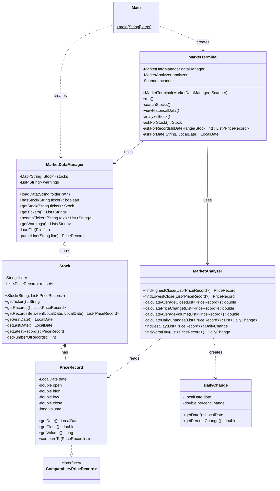

# Mini Market Terminal: Milestone 1

**Historical Stock Data and Basic Analysis.** Fairfield University OOP Lab,
Fall 2026, Semester Project #2.

A text-based Java program that loads the historical stock data provided by the
instructor and lets the user search for a stock, view its historical prices,
and analyze its performance over a date range.

```
================================================
              MINI MARKET TERMINAL
================================================
1. Search Stock
2. View Historical Data
3. Analyze Stock
0. Exit
```

## How to run

You need Java (JDK) 17 or newer. You do **not** need to install Maven: the
included Maven Wrapper (`mvnw` / `mvnw.cmd`) downloads it the first time.

```powershell
# Windows (PowerShell), from this folder
.\mvnw.cmd package
java -jar target\mini-market-terminal.jar
```

```bash
# macOS / Linux
sh mvnw package
java -jar target/mini-market-terminal.jar
```

`package` compiles the code, runs the tests, and builds the jar file. Run the
program from this folder, because it looks for the `data` folder here.

**In IntelliJ or VS Code:** open this folder and run `Main.java`.

## How to use it

Type a menu number and press Enter.

| Option | What it does |
|---|---|
| **1. Search Stock** | Type a ticker or part of one (e.g. `G` finds AVGO and GOOGL). Press Enter alone to list every stock. |
| **2. View Historical Data** | Choose a stock and a date range to see each day's Open, High, Low, Close and Volume. |
| **3. Analyze Stock** | Choose a stock and a date range to see the analysis below. |

- Dates are entered as `MM/DD/YYYY`, e.g. `03/31/2025`.
- At a date prompt, pressing **Enter** uses the first (or last) date in the data.
- At a ticker prompt, pressing **Enter** goes back to the menu.

**Example: Analyze Stock, NVDA, 01/01/2025 to 03/31/2025**
```
Ticker: NVDA
Period: 01/02/2025 - 03/31/2025 (60 trading days)

Highest Closing Price:    $149.43 on 01/06/2025
Lowest Closing Price:     $106.98 on 03/10/2025
Average Closing Price:    $126.74
Price Change:             -21.64%
Average Trading Volume:   281,460,689

Best Trading Day:         01/28/2025 (+8.93%)
Worst Trading Day:        01/27/2025 (-16.97%)
```

The period shown starts on 01/02/2025 because 01/01 was a holiday; the report
shows the trading days that were actually used.

## Architecture

The program has **7 classes**, all in the package `market`
(`src/main/java/market/`). Each class has one job:

| Class | Responsibility |
|---|---|
| `Main` | Starts the program: loads the data and starts the menu. |
| `MarketTerminal` | The user interface: shows the menu, reads input with a `Scanner`, checks that the input is valid, and prints the results. |
| `MarketDataManager` | Reads the CSV files and stores the stocks in a `TreeMap` (ticker → `Stock`). Finds stocks by ticker. |
| `Stock` | One stock: its ticker and an `ArrayList` of `PriceRecord`s sorted by date. Can return the records between two dates. |
| `PriceRecord` | One day of data: date, open, high, low, close, volume. Implements `Comparable` so records can be sorted by date. |
| `MarketAnalyzer` | Does all the calculations. Each requirement is one method (see the table below). It never prints anything. |
| `DailyChange` | A date plus the % change from the previous day. Returned for the best and worst trading day. |

**How a request flows through the program (Analyze Stock):**
1. `MarketTerminal` asks for a ticker and gets the `Stock` from `MarketDataManager`.
2. `MarketTerminal` asks for a start and end date and gets the matching
   `PriceRecord`s from `Stock.getRecordsBetween(...)`.
3. `MarketTerminal` passes that list to the `MarketAnalyzer` methods and prints each result.

### UML class diagram



(`PriceRecord` also has `getOpen()`, `getHigh()` and `getLow()`; they are left
out of the diagram to keep it short.)

## Milestone 1 requirements

| Requirement | Where it is done |
|---|---|
| Select or search for a stock by ticker | `MarketTerminal.searchStocks()` / `askForStock()`, `MarketDataManager.searchTickers()` / `getStock()` |
| Display historical records | `MarketTerminal.viewHistoricalData()` |
| Specify a date range | `MarketTerminal.askForRecordsInDateRange()`, `Stock.getRecordsBetween()` |
| Highest closing price | `MarketAnalyzer.findHighestClose()` |
| Lowest closing price | `MarketAnalyzer.findLowestClose()` |
| Average closing price | `MarketAnalyzer.calculateAverageClose()` |
| % price change over the period | `MarketAnalyzer.calculatePriceChange()` |
| Average trading volume | `MarketAnalyzer.calculateAverageVolume()` |
| Day with the largest % increase | `MarketAnalyzer.findBestDay()` |
| Day with the largest % decrease | `MarketAnalyzer.findWorstDay()` |
| Invalid ticker symbols | `askForStock()` prints the available tickers and asks again |
| Invalid date ranges | `askForDate()` rejects bad dates; `askForRecordsInDateRange()` rejects a start after the end and ranges without enough data |
| Missing files | `loadData()` throws `FileNotFoundException` if the folder or the CSV files are missing; `Main` prints the error. Bad rows or files are skipped and listed as warnings. |
| Text-based interface | `MarketTerminal` |

### How the numbers are calculated
- **Price change** = (last close − first close) / first close × 100, using the first and last trading days in the period.
- **Daily change** = (today's close − yesterday's close) / yesterday's close × 100.
  The first day of the period has no "yesterday" in the period, so it has no daily change.
- **Best / worst trading day** = the day with the largest / smallest daily change.
- **Analyze Stock** needs at least 2 trading days in the period, because a daily change compares two days.

## Data

The `data` folder holds the instructor's files: 10 stocks (AAPL, AMZN, AVGO,
BRK, GOOGL, LLY, META, MSFT, NVDA, TSLA), each with 250 trading days in 2025.
Each file is named `TICKER_2025.csv` and starts with the header line
`Date,Open,High,Low,Close,Volume`. The ticker comes from the file name.

## Tests

The `src/test/java/market` folder has JUnit 5 tests (21 tests in 3 files):
- `MarketAnalyzerTest`: each calculation, using small made-up price lists
- `MarketDataManagerTest`: loading the real data, bad rows, missing folders
- `MarketTerminalTest`: runs the menu with typed-in answers and checks the output

Run them with `.\mvnw.cmd test` (Windows) or `sh mvnw test` (macOS/Linux).

**External libraries:** JUnit 5 (tests only). The program itself uses only the
Java standard library.

## Team members and tasks

> **TODO:** fill in who did what. The assignment requires this for every milestone.

| Member | Tasks |
|---|---|
| Matt F | |
| David S | |
