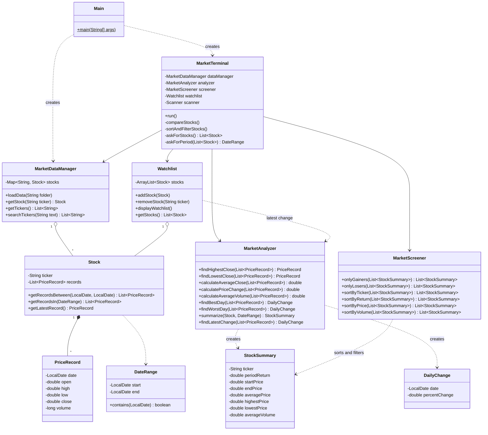

# Mini Market Terminal (Milestone 2)

The Milestone 1 program turned into a small market terminal. Everything from
Milestone 1 still works, and you can now keep a watchlist, compare stocks side
by side, and sort and filter stocks.

## How to run

You need Java 17 or newer. Run these commands from the `Milestone_2` folder:

**Windows**
```
.\mvnw.cmd package
java -jar target\mini-market-terminal.jar
```

**Mac / Linux**
```
sh mvnw package
java -jar target/mini-market-terminal.jar
```

`package` also runs the 39 unit tests. In IntelliJ, open the `Milestone_2`
folder and run `market.Main`.

## How to use it

Type a menu number and press Enter. Type dates as `MM/DD/YYYY`, for example `03/31/2025`.

```
Market Terminal
---------------
1. Search Stock
2. View Historical Data
3. Analyze Stock
4. View Watchlist
5. Add Stock to Watchlist
6. Remove Stock from Watchlist
7. Compare Stocks
8. Sort & Filter Stocks
0. Exit
```

- **1-3 (Milestone 1):** search for a ticker, show a stock's daily prices, or
  analyze a stock over a date range.
- **4. View Watchlist:** each stock's latest available price (the most recent
  close in the data) and its change from the trading day before.
- **5 / 6. Add / Remove:** add a stock by ticker, or remove one.
- **7. Compare Stocks:** type 2 or more tickers (`AAPL NVDA MSFT`), or `W` to
  compare your watchlist, then a date range.
- **8. Sort & Filter Stocks:** one quick list of all stocks over the whole
  period in the data. Pick one option: gainers (filter + sort by % change),
  losers, price, volume, or ticker A to Z.

If you type something invalid (an unknown ticker, a wrong date, a start date
after the end date, a period with no data, letters instead of a number), the
program says what is wrong and asks again.

**Example: 7. Compare Stocks (AAPL NVDA MSFT, 01/01/2025 - 12/31/2025)**
```
                           AAPL           NVDA           MSFT
-------------------------------------------------------------
Period Return           +11.49%        +34.84%        +15.54%
Start Price             $243.85        $138.31        $418.58
End Price               $271.86        $186.50        $483.62
Average Price           $232.24        $153.90        $464.43
Highest Price           $286.19        $207.04        $542.07
Lowest Price            $172.42         $94.31        $354.56
Average Volume       54,172,956    220,762,106     22,194,108
Trading Days                250            250            250

Best performer:   NVDA (+34.84%)
Worst performer:  AAPL (+11.49%)
```

**Example: 4. View Watchlist**
```
Ticker     Latest Available Price     Change
--------------------------------------------
AAPL                      $271.86     -0.45%
NVDA                      $186.50     -0.55%
MSFT                      $483.62     -0.79%
```

## Classes

| Class | What it does | Milestone 2 |
|---|---|---|
| `Main` | Starts the program | same |
| `MarketTerminal` | Shows the menu, reads what the user types, prints the results | added options 7 and 8, and input checks for them |
| `MarketDataManager` | Loads the CSV files | same |
| `Stock` | One stock and its price history | added `getRecordsIn(DateRange)` |
| `PriceRecord` | One day of prices | same |
| `MarketAnalyzer` | Does the calculations | added `summarize()` and `findLatestChange()` |
| `DailyChange` | A day and its % change | same |
| `Watchlist` | The user's list of stocks: add, remove, display | **new** (display shows the latest price and change) |
| `DateRange` | A start and end date that are always in the right order | **new** |
| `StockSummary` | One stock's numbers over a period (return, prices, volume) | **new** |
| `MarketScreener` | Filters and sorts a list of `StockSummary` | **new** |

## UML class diagram



## What changed since Milestone 1

| Class | Change | Why |
|---|---|---|
| `MarketTerminal` | `askForDateRange` now uses a new `askForPeriod`, which works for a list of stocks | Comparing and sorting need one period that every chosen stock has data for. Milestone 1 could only check one stock. |
| `DateRange` (new) | The start and end date are kept in one object | The period is passed around much more now, and a period with the start after the end cannot be created. |
| `MarketAnalyzer` | New `summarize()` method | Compare Stocks and Sort & Filter need the same numbers for each stock. `summarize()` reuses the Milestone 1 methods, so nothing is calculated twice. |
| `Watchlist` | The display is now a table with the latest price and the % change. `getStocks()` was added | Matches the assignment's watchlist example, and lets you compare or sort your watchlist. |

**Could be refactored later:** `MarketTerminal` is getting long, because it both
reads input and prints results for every option. Moving the input methods
(`askForStock`, `askForPeriod`, `askForChoice`, ...) into their own class would
make it shorter. The watchlist is also only kept while the program runs; it
could be saved to a file.

## Java concepts used

- **Collections:** `ArrayList`, `TreeMap` (stocks in alphabetical order), and a `LinkedHashSet` to ignore duplicate tickers.
- **Comparable and Comparator:** `PriceRecord` sorts by date, and `MarketScreener` sorts by ticker, return, price and volume.
- **Lambdas and streams:** filtering in `MarketScreener`, and choosing which value each row of the comparison table shows.
- **Exceptions:** invalid numbers, dates and missing files are caught, and the user is asked again.

## Data

The `data` folder has 2025 prices for 10 stocks: AAPL, AMZN, AVGO, BRK, GOOGL,
LLY, META, MSFT, NVDA and TSLA.

## Team members

> **TODO:** check and complete before submitting.

| Member | Tasks |
|---|---|
| Matt F | Watchlist: add, remove and display stocks |
| David S | |
